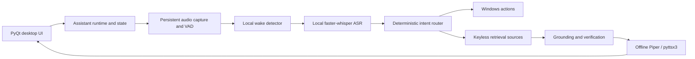

# Chintu AI

Chintu AI is a Windows desktop voice-assistant project being rebuilt around local audio processing, deterministic PC actions, and short answers grounded in retrieved sources. The current checkout is the Phase 0 foundation: the desktop overlay and runtime shell start, but the voice pipeline is intentionally not active yet.

## Current status

| Capability | Current state | Planned module |
|---|---|---|
| Desktop overlay | Existing PyQt6 overlay, now under `chintu/ui/` | `chintu/ui/chintu_ui.py` |
| Runtime state and configuration | Phase 0 foundation | `chintu/state.py`, `chintu/config.py` |
| Audio capture and VAD | Phase 1: persistent microphone input and utterance segmentation | `chintu/audio/capture.py`, `chintu/audio/vad.py` |
| Local wake-word detection | Not implemented yet | `chintu/audio/wake.py` |
| Local Whisper transcription | Not implemented yet | `chintu/asr.py` |
| Deterministic Windows actions | Not wired into this runtime yet | `chintu/actions/` |
| Grounded retrieval and answer verification | Not implemented yet | `chintu/rag/` |
| Offline speech output | Not wired into this runtime yet | `chintu/tts.py` |

The former voice pipeline was removed to eliminate cloud speech recognition, keyed generation, and network TTS. Its local replacement is being built one phase at a time; the current phase captures and segments speech but does not yet transcribe or answer.

## Setup

Supported target: Windows 10/11 and Python 3.10–3.12. CPU-only operation is the design target; no GPU is required.

1. Copy `config.toml.example` to `config.toml` if you want to customize local settings. `config.toml` is ignored by Git.
2. Run `run_chintu.bat`. It creates a virtual environment, installs `requirements.txt`, prepares the models directory when needed, and launches the desktop shell.
3. For a dependency/device report, run `venv\Scripts\python scripts\doctor.py`.
4. Run the automated checks with `venv\Scripts\python -m pytest -q`.

Phase 1 opens one persistent microphone stream, calculates live RMS for the UI, and detects speech boundaries. Silero VAD runs on CPU when its checksum-verified model exists; otherwise the local WebRTC VAD fallback is used. A bounded in-memory frame queue and pre-roll buffer preserve speech onset and prevent a slow consumer from growing memory without bound. The runtime retries the input stream after device errors. It does not yet recognize wake words, transcribe speech, perform actions, answer questions, or speak. Unit tests do not require a microphone; use the doctor script to check a real input device and report capture/VAD timing.

## Configuration and local files

Defaults are documented in `config.toml.example`. Phase 1 audio settings include sample rate, frame size, pre-roll, speech-onset confirmation, end silence, maximum utterance duration, VAD threshold, WebRTC aggressiveness, and stream recovery interval. Local settings live in `config.toml`; logs are written to the rotating `logs/chintu.log`; downloaded model files belong in `models/`. These local paths are ignored by Git. Invalid TOML or an unsupported setting is reported as a configuration error rather than silently replaced with defaults.

## No API keys, ever

The assistant does not use API keys, accounts, paid services, or hosted language models. The Phase 0 runtime makes no network requests. Later phases may use only the following keyless public services or model distribution sites:

| Service | Intended purpose | Data sent |
|---|---|---|
| Silero VAD model on GitHub | One-time local VAD model download | Public ONNX model request only; no audio |
| DuckDuckGo | Public web search | Search query text |
| Wikipedia/Wikidata REST APIs | Entity lookup and public reference information | Search/entity query |
| Open-Meteo | Weather and geocoding | Location query/coordinates |
| Public RSS/Atom feeds | Current-event retrieval | Feed URL requests; no audio |
| Public model distribution endpoints | One-time model downloads | Model file requests; no audio |
| Retrieved public web pages | Source text for answer grounding | Page URL requests; no audio |

Microphone audio remains on the device in Phase 1 and is processed in memory by local VAD. Search text can be sent only to the keyless public services listed above when retrieval is implemented. Grounding, verification, and abstention are intended to reduce unsupported answers; answer quality still depends on the quality and availability of the sources.

## Architecture (planned)

The diagram describes the target pipeline; the current runtime implements the desktop shell, configuration, state foundation, persistent input capture, and VAD only.

## Development and evaluation

See [docs/DEVLOG.md](docs/DEVLOG.md) for phase-by-phase progress and [docs/results/](docs/results/) for test and evaluation reports. No wake-word, ASR, retrieval-accuracy, or latency evaluation has been run yet; those figures will be added when their respective evaluation scripts exist.
