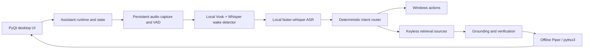

# Chintu AI

Chintu AI is a Windows desktop voice-assistant project being rebuilt around local audio processing, deterministic PC actions, and short answers grounded in retrieved sources. The current checkout includes the Phase 0 foundation, Phase 1 audio capture/VAD, Phase 2 local wake-word detection, Phase 3 local command transcription, and Phase 4 deterministic local actions.

## Current status

| Capability | Current state | Planned module |
|---|---|---|
| Desktop overlay | Existing PyQt6 overlay, now under `chintu/ui/` | `chintu/ui/chintu_ui.py` |
| Runtime state and configuration | Phase 0 foundation | `chintu/state.py`, `chintu/config.py` |
| Audio capture and VAD | Phase 1: persistent microphone input and utterance segmentation | `chintu/audio/capture.py`, `chintu/audio/vad.py` |
| Local wake-word detection | Phase 2: VAD-gated Vosk grammar candidate plus faster-whisper confirmation | `chintu/audio/wake.py` |
| Local command transcription | Phase 3: faster-whisper CPU/int8 with confidence filtering | `chintu/asr.py` |
| Deterministic Windows actions | Phase 4: local intent routing and Windows action execution; destructive actions require confirmation | `chintu/actions/` |
| Grounded retrieval and answer verification | Not implemented yet | `chintu/rag/` |
| Offline speech output | Not wired into this runtime yet | `chintu/tts.py` |

The former voice pipeline was removed to eliminate cloud speech recognition, keyed generation, and network TTS. The current runtime can confirm a wake phrase, transcribe a follow-up command, and execute supported deterministic local actions. General question answering and speech output are not connected yet.

## Setup

Supported target: Windows 10/11 and Python 3.10–3.12. CPU-only operation is the design target; no GPU is required.

1. Copy `config.toml.example` to `config.toml` if you want to customize local settings. `config.toml` is ignored by Git.
2. Run `run_chintu.bat`. It creates a virtual environment, installs `requirements.txt`, downloads the local VAD/wake models when needed, and starts the assistant in the background. The overlay stays hidden until the wake phrase is confirmed.
3. For a dependency/device report, run `venv\Scripts\python scripts\doctor.py`.
4. Run the automated checks with `venv\Scripts\python -m pytest -q`.

Phase 1 opens one persistent microphone stream, calculates live RMS for the UI, and detects speech boundaries. Silero VAD runs on CPU when its checksum-verified model exists; otherwise the local WebRTC VAD fallback is used. A bounded in-memory frame queue and pre-roll buffer preserve speech onset and prevent a slow consumer from growing memory without bound. The runtime retries the input stream after device errors.

Phase 2 continuously checks VAD-delimited speech segments for the wake phrase while the UI remains hidden and the runtime stays asleep. Segments are sent to a local Vosk recognizer with phonetic candidates such as `"chin to"` and `"chin two"`; a candidate is confirmed by local faster-whisper base transcription over the segment's last two seconds, with RapidFuzz matching for configured phrases and phonetic variants. Only after confirmation does the overlay appear and the runtime enter its listening state. `wake_sensitivity` ranges from `0.0` (strict) to `1.0` (more permissive); `wake_cooldown_seconds` prevents repeated triggers.

Phase 3 passes only new VAD-delimited speech captured after wake confirmation to a background command-ASR worker. faster-whisper runs locally on CPU with int8 quantization; the default `base` model is loaded once and shared with wake confirmation to avoid a duplicate model in memory. Transcripts are retained as both raw text and normalized command text. The normalizer removes leading wake/filler phrases and converts cardinal number words through 99 to digits. Likely silence or hallucinations are rejected using Whisper's no-speech probability, average log probability, and compression ratio. ASR settings are in `config.toml.example`. The default `base` model is prepared with `python scripts/download_models.py --wake`; for another model size, use `python scripts/download_models.py --wake --whisper-model small.en` (replace the size as needed).

Phase 4 routes normalized commands to a deterministic local intent router and Windows action executor. Supported actions include opening apps and HTTPS websites, closing apps, volume/brightness/media controls, locking the workstation, screenshots, local date/time and system status, timers, alarms, and power operations. Closing apps and power operations require a separate spoken confirmation; shutdown/restart are scheduled with a delay and can be canceled. General information requests are recognized but not answered until retrieval is implemented. Automated tests cover the router and injected action boundaries; live behavior of Windows actions still needs manual validation on the target machine.

The model downloader fetches the Indian-English small Vosk model from its public model endpoint and verifies the pinned archive SHA-256 before safe extraction. It prepares faster-whisper models in the local Hugging Face model cache. Runtime model loading uses `local_files_only=True`, so it does not fetch models while processing microphone audio. Use `python scripts/download_models.py --wake` to prepare the default model assets manually.

Wake-word evaluation uses labeled 16 kHz PCM16 WAV files and reports positive miss rate and negative false accepts per audio hour:

```powershell
python scripts\eval_wake.py --positive-dir eval\wake\positive --negative-dir eval\wake\negative --report eval\wake\report.json
```

Unit tests do not require a microphone; use the doctor script to check a real input device and report capture/VAD timing.

Command-ASR evaluation expects one post-wake command per 16 kHz, mono, PCM16 WAV file and a same-named `.txt` reference beside it. The report includes raw WER and normalized-command WER, including a per-utterance transcript and rejection reason:

```powershell
python scripts\eval_asr.py --audio-dir eval\asr\clips --report eval\asr\report.json
```

The evaluator runs the configured local model and does not upload audio. Its JSON report contains transcribed text, so keep the report local and do not commit personal recordings or transcripts.

## Configuration and local files

Defaults are documented in `config.toml.example`. Phase 1 audio settings include sample rate, frame size, pre-roll, speech-onset confirmation, end silence, maximum utterance duration, VAD threshold, WebRTC aggressiveness, and stream recovery interval. Phase 2 adds wake confirmation window, fuzzy-match sensitivity, and cooldown settings. Phase 3 adds the command-ASR model size and rejection thresholds. Local settings live in `config.toml`; logs are written to the rotating `logs/chintu.log`; downloaded Vosk model files belong in `models/`, and faster-whisper models are cached locally by Hugging Face. These local paths are ignored by Git. Invalid TOML or an unsupported setting is reported as a configuration error rather than silently replaced with defaults.

## No API keys, ever

The assistant does not use API keys, accounts, paid services, or hosted language models. The Phase 0 runtime makes no network requests. Later phases may use only the following keyless public services or model distribution sites:

| Service | Intended purpose | Data sent |
|---|---|---|
| Silero VAD model on GitHub | One-time local VAD model download | Public ONNX model request only; no audio |
| Indian-English Vosk model endpoint | One-time local wake model download | Public model archive request only; no audio |
| Hugging Face | One-time local faster-whisper model download | Public model files only; no audio |
| DuckDuckGo | Public web search | Search query text |
| Wikipedia/Wikidata REST APIs | Entity lookup and public reference information | Search/entity query |
| Open-Meteo | Weather and geocoding | Location query/coordinates |
| Public RSS/Atom feeds | Current-event retrieval | Feed URL requests; no audio |
| Public model distribution endpoints | One-time model downloads | Model file requests; no audio |
| Retrieved public web pages | Source text for answer grounding | Page URL requests; no audio |

Microphone audio remains on the device and is processed in memory by local VAD and local Vosk/Whisper models. Search text can be sent only to the keyless public services listed above when retrieval is implemented. Grounding, verification, and abstention are intended to reduce unsupported answers; answer quality still depends on the quality and availability of the sources.

## Architecture (planned)



The diagram describes the target pipeline; the current runtime implements the desktop shell, configuration, state foundation, persistent input capture, VAD, wake-word confirmation, local command ASR, and deterministic Windows actions. Retrieval, answer verification, and TTS remain planned.

## Development and evaluation

See [docs/DEVLOG.md](docs/DEVLOG.md) for phase-by-phase progress and [docs/results/](docs/results/) for test and evaluation reports. Run `scripts/eval_wake.py` with labeled positive and negative speech samples to measure wake miss rate and false accepts/hour; these accuracy metrics are not yet available because no labeled speech corpus has been evaluated.
